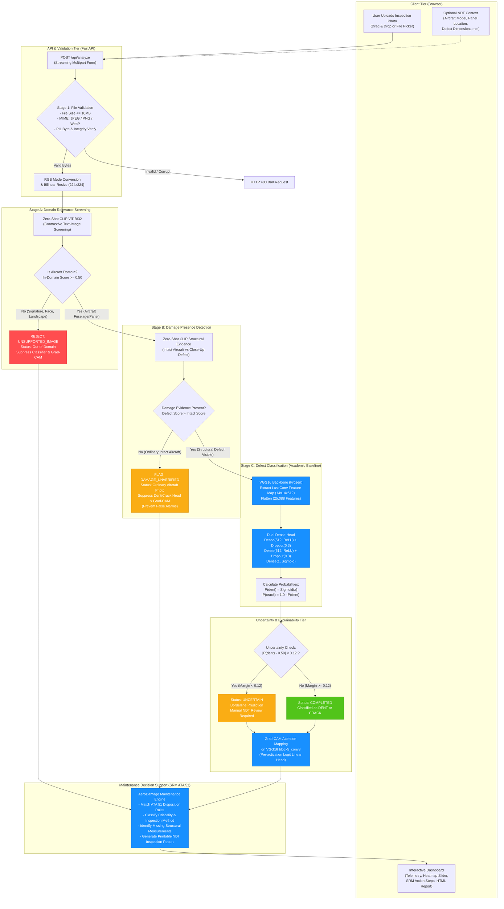
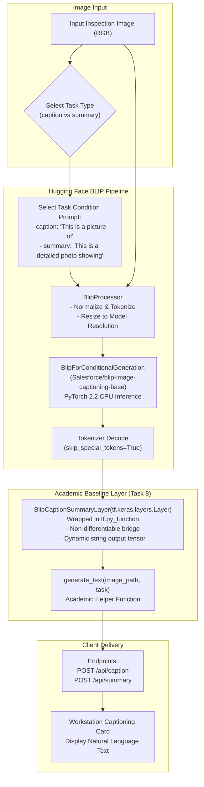

# AeroDamage AI — Complete System Architecture & Pipeline Specification

**Document Version:** 1.0.0  
**Date:** 2026-10-28  
**Project:** AeroDamage AI — Aircraft Damage Classification, Image Captioning and Summarization  
**Auditor Roles:** Principal Software Architect, Deep Learning Engineer, Computer Vision Researcher  

---

## 1. Architectural Philosophy & Safety Posture

AeroDamage AI automates visual non-destructive inspection (NDI) and description of aircraft structural damage. In aviation safety engineering, an automated inspection system must be **defensive by design**:

1. **Closed-World Fallacy Elimination:** A binary model trained exclusively on images of defects (`dent` and `crack`) must **never** be presented as an autonomous damage detector. Without explicit domain and damage-presence screening, it will assign high-confidence damage scores to benign aircraft surfaces or unrelated images (such as signatures).
2. **Defensive Staging:** Inspection occurs in sequential gates. If an input fails an early gate (e.g. non-aircraft or undamaged aircraft), subsequent classification heads and visual explainability heatmaps are suppressed to avoid misleading maintenance personnel.
3. **Multimodal Decoupling:** Image captioning via BLIP provides natural language surface descriptions, but is strictly decoupled from quantitative damage classification and does not serve as structural validation.

---

## 2. System Architecture Diagrams

### 2.1 Multi-Stage Aircraft Structural Damage Inspection Flow

The following sequence details how an uploaded image traverses the defensive inspection pipeline.



---

### 2.2 Multimodal Vision-Language Captioning & Summarization Flow (BLIP)

The image captioning and summarization pipeline runs independently of the structural classifier.



---

## 3. Detailed Stage-by-Stage Technical Analysis

### Stage 1: File & Image Validation
- **Location:** `src/aircraft_ai/api.py:L45-74`
- **Responsibilities:**
  1. Enforces upload ceiling (`MAX_UPLOAD_SIZE_MB = 10`). Rejects payloads exceeding limit with `HTTP 413`.
  2. Verifies MIME type allowlist (`image/jpeg`, `image/png`, `image/webp`).
  3. Uses Pillow's `Image.open(io.BytesIO(file_bytes)).verify()` to confirm image header and compression integrity without executing arbitrary code.
  4. Decodes and re-encodes into strict 3-channel RGB, converting transparency channels (RGBA/LA) via white-matte alpha compositing.
- **Status:** **Implemented, Verified, and Tested.**

### Stage 2: Aircraft-Image Domain Screening (Stage A)
- **Location:** `src/aircraft_ai/domain_screening.py:L71-120`
- **Methodology:** Pretrained zero-shot contrastive image-text alignment using `openai/clip-vit-base-patch32`.
- **Target Prompt Ensembles:**
  - *In-Domain Prompts:* Close-up technical inspection photos of aircraft metal fuselage skins, wings, and composite panels.
  - *Out-of-Domain Prompts:* Signatures, handwritten text, cursive documents, human portraits, road vehicles, natural landscapes, and cartoon illustrations.
- **Decision Logic:** Softmax over pooled prompt logits. If in-domain score $< 0.50$, the image is rejected as `UNSUPPORTED_IMAGE`.
- **Status:** **Implemented, Verified, and Tested.** (Prevents the signature misclassification bug).

### Stage 3: Damage-Presence Detection (Stage B)
- **Location:** `src/aircraft_ai/domain_screening.py:L140-200`
- **The Core Problem:** The project's training dataset contains **only 446 images of structural defects (223 dent, 223 crack)**. It contains **zero images of intact, undamaged aircraft**.
- **Current Technical Implementation:**
  - Uses CLIP contrastive zero-shot screening contrasting prompts for:
    - *Intact Aircraft:* "an ordinary undamaged aircraft in flight or parked at an airport gate with clean exterior surface".
    - *Damaged Panel:* "a close-up technical inspection photograph showing structural skin damage, crack, or dent".
  - If the image depicts an intact aircraft without close-up damage features, the pipeline sets `damage_presence_status = NOT_ASSESSED`, suppresses the VGG16 binary head, withholds Grad-CAM, and outputs `STATUS_DAMAGE_UNVERIFIED`.
- **Future Production Requirement:** A genuinely certified damage-presence detector requires training a binary classifier on a balanced dataset of at least **1,000+ verified undamaged aircraft panel images** alongside damaged panels.
- **Status:** **Implemented via CLIP Screening Safeguard; Documented as Academic Limitation.**

### Stage 4: Dent-versus-Crack Classification (Stage C — Academic Baseline)
- **Location:** `src/aircraft_ai/classifier.py:L17-58`, `src/aircraft_ai/inference.py:L88-114`
- **Model Architecture:**
  - Backbone: Pretrained VGG16 on ImageNet (`include_top=False`, input shape `(224, 224, 3)`).
  - All 19 convolutional layers frozen (`trainable = False`).
  - Flatten layer: 25,088 features.
  - Dense layer 1: 512 units, ReLU activation.
  - Dropout layer 1: 30% dropout rate (`p = 0.30`).
  - Dense layer 2: 512 units, ReLU activation.
  - Dropout layer 2: 30% dropout rate (`p = 0.30`).
  - Classification head: 1 unit with Sigmoid activation ($\sigma(z) \in [0, 1]$).
- **Class Mapping:** Class `0` = `crack`, Class `1` = `dent`.
- **Decision Threshold:** $\tau = 0.50$ (predicted as `dent` if $P(\text{dent}) > 0.50$, else `crack`).
- **Status:** **Implemented, Trained, Checkpointed (`vgg16_aircraft_damage.keras`), and Verified.**

### Stage 5: Uncertainty & Borderline Decision Logic
- **Location:** `src/aircraft_ai/inference.py:L349-370`
- **Uncertainty Margin:** $\Delta = \pm 0.12$.
  $$\text{Margin} = |P(\text{dent}) - 0.50|$$
- **Decision Rules:**
  - If $\text{Margin} < 0.12$ ($P(\text{dent}) \in [0.38, 0.62]$), status is marked `UNCERTAIN`.
  - The UI highlights the result in warning amber and triggers a mandatory non-destructive testing (NDT) manual verification workflow.
- **Status:** **Implemented, Verified, and Tested.**

### Stage 6: Model Explainability via Grad-CAM
- **Location:** `src/aircraft_ai/gradcam.py:L1-216`
- **Target Layer:** Last convolutional layer of VGG16 (`block5_conv3`, feature map shape `14 × 14 × 512`).
- **Mathematical Refinement:**
  - Standard Grad-CAM on sigmoid outputs suffers from **gradient saturation** when predictions are confident ($\sigma'(z) \to 0$).
  - AeroDamage AI constructs a submodel extracting the **pre-activation logit $z$** using an auxiliary linear dense layer initialized with the trained weights:
    $$\alpha_k^c = \frac{1}{Z} \sum_{i} \sum_{j} \frac{\partial z^c}{\partial A_{i,j}^k}$$
    $$L_{\text{Grad-CAM}}^c = \text{ReLU}\left( \sum_k \alpha_k^c A^k \right)$$
  - Generates high-contrast jet/turbo heatmaps and blended overlays rendered directly on the frontend via HTML5 canvas with variable opacity controls.
- **Status:** **Implemented, Verified, and Tested.**

### Stage 7: BLIP Multimodal Captioning & Summarization
- **Location:** `src/aircraft_ai/captioning.py`, `src/aircraft_ai/blip_layer.py`
- **Model:** `Salesforce/blip-image-captioning-base` (~990 MB weights).
- **Prompt Conditioning:**
  - Task 9 (Caption): `"This is a picture of"`
  - Task 10 (Summary): `"This is a detailed photo showing"`
- **Custom Keras Layer:** `BlipCaptionSummaryLayer` and `generate_text(image_path, task)` strictly implemented per Task 8 of the notebook.
- **Status:** **Implemented, Verified, and Tested.**

### Stage 8: Maintenance Decision Support (SRM ATA 51)
- **Location:** `src/aircraft_ai/maintenance.py:L1-850`
- **Scope:** Translates deep learning outputs into compliant aerospace engineering guidance aligned with Boeing/Airbus Structural Repair Manual (SRM) standards:
  - Dispositions: Immediate AOG grounding, repetitive NDT inspection, or allowable operational limits.
  - Recommended NDT Methods: High-Frequency Eddy Current (HFEC) for cracks; dial depth gauges / ultrasonic thickness for dents.
  - Regulatory Disclaimers: Mandatory FAA/EASA non-certification disclosures.
- **Status:** **Implemented, Verified, and Tested.**

---

## 4. Component Boundaries & Concurrency Model

```
+--------------------------------------------------------------------------------+
|                           FASTAPI WEB SERVICE LAYER                            |
|                                                                                |
|  [POST /api/analyze]   [POST /api/caption]   [POST /api/summary]   [GET /health]
+-------------------+--------------------+--------------------+------------------+
                    |                    |                    |
                    v                    v                    v
+--------------------------------------------------------------------------------+
|                        IN-MEMORY SINGLETON & MUTEX TIER                        |
|                                                                                |
|   +-----------------------+  +-----------------------+  +-------------------+  |
|   |  VGG16 Keras Singleton|  |   CLIP Model Singleton|  |BLIP PyTorch Single|  |
|   |  (Loaded from .keras) |  |   (clip-vit-base)     |  |(blip-base)        |  |
|   |  Lock: None (Thread-  |  |   Lock: _CLIP_LOCK    |  |Lock: _BLIP_LOCK   |  |
|   |  safe predict())      |  |   (Atomic eval)       |  |(Atomic generate())|  |
|   +-----------------------+  +-----------------------+  +-------------------+  |
+--------------------------------------------------------------------------------+
                    |                    |                    |
                    v                    v                    v
+--------------------------------------------------------------------------------+
|                        PERSISTENCE & ARTIFACTS TIER                            |
|                                                                                |
|  - artifacts/models/vgg16_aircraft_damage.keras (206 MB)                       |
|  - artifacts/results/metrics.json, history.json, dataset_report.json           |
|  - data/aircraft_damage_dataset_v1/{train, valid, test} (446 Images)           |
+--------------------------------------------------------------------------------+
```

### Concurrency Guarantees
- VGG16 inference uses Keras 3 `model.predict(batch, verbose=0)` which is internally thread-safe for forward-pass execution.
- CLIP and BLIP PyTorch models use explicit Python `threading.Lock()` mutexes around forward-pass generation calls to prevent CUDA/CPU thread contention on multi-core Windows environments.
